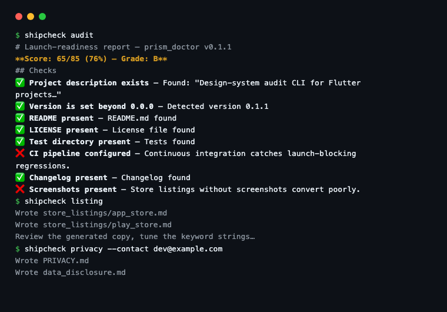
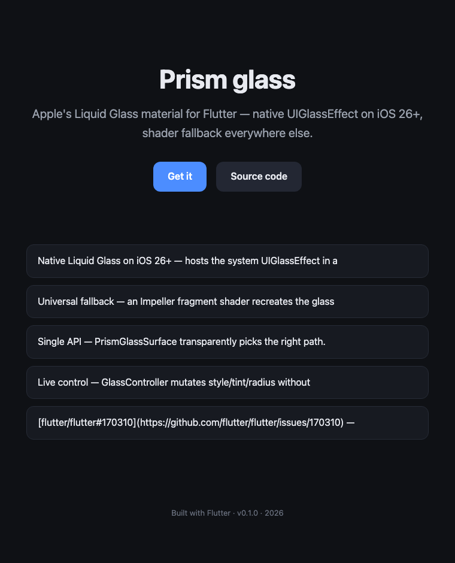

# 🚢 shipcheck

**The last mile of shipping apps.**

Vibe coders and AI-assisted developers can build an app in hours — but
*shipping* it still takes days: store listings, privacy policies, release
notes, a landing page, and a dozen forgotten details that get apps rejected.

`shipcheck` reads your project (Flutter, Dart, Node, iOS, Android) and
generates the entire launch kit from one command — then scores how ready
you actually are.

```
$ shipcheck audit
# Launch-readiness report — prism_doctor v0.1.1
**Score: 65/85 (76%) — Grade: B**
```



---

## Why this exists

There are thousands of tools that help you *build* faster. There are
almost none that help you *ship*. Every feature here answers a question
that blocks real launches:

| Question | Command |
|---|---|
| Is my project actually ready to submit? | `shipcheck audit` |
| What do I type into App Store Connect / Play Console? | `shipcheck listing` |
| What's my privacy policy and data-safety disclosure? | `shipcheck privacy` |
| What changed since the last release? | `shipcheck release` |
| Where does my marketing page come from? | `shipcheck site` |

## Install

```bash
dart pub global activate shipcheck
```

Or run from source:

```bash
git clone https://github.com/awaisdev5765/shipcheck.git
cd shipcheck
dart pub global activate --source path .
```

Requires Dart ≥ 3.4.

## Commands

### `shipcheck audit`

Scores launch-readiness across 9 weighted checks (metadata, README,
license, tests, CI, changelog, privacy policy, icons, screenshots) on a
0–100 scale with an A–F grade. Exit code is always 0; pass
`--fail-on <grade>` in CI (roadmap) to gate releases.

```bash
shipcheck audit              # print to stdout
shipcheck audit -o report.md # write Markdown report
```

### `shipcheck listing`

Generates App Store and Play Store listing copy from your project
metadata and README: title, subtitle/short description, keyword set,
and a structured long description with feature bullets — every field
labeled with its store's character limit so you can paste directly.

```bash
shipcheck listing                       # writes store_listings/
shipcheck listing -o my_listings        # custom output directory
```

### `shipcheck privacy`

Scans your dependency manifest for network, ads, and analytics packages,
then generates:

- `PRIVACY.md` — a complete privacy policy you can host and link
- `data_disclosure.md` — pre-filled answers for the App Store *App
  Privacy* and Play *Data Safety* questionnaires

```bash
shipcheck privacy --contact you@example.com
```

> ⚠️ Generated policies are a starting point, not legal advice. Edit the
> data-handling statements to match what your app actually does.

### `shipcheck release`

Turns git history into human release notes. Commit subjects are
classified by conventional-commit prefix (`feat:` → **New**, `fix:` →
**Fixed**, chores/docs/tests filtered out) and rewritten into clean,
user-facing prose.

```bash
shipcheck release                        # since the latest tag
shipcheck release --from v1.0.0 --to HEAD
```

### `shipcheck site`

Generates a self-contained one-page marketing site (`index.html`, inline
CSS, zero dependencies) from your project name, description, version,
and README bullets. Dark-mode friendly. Host it on GitHub Pages as-is.

```bash
shipcheck site --repo https://github.com/you/yourapp
```



## How it works

`shipcheck` never phones home and never needs your store credentials.
It reads files you already have:

```
pubspec.yaml / package.json   → name, version, description, dependencies
README.md                     → feature bullets for listings and the site
.git                          → commit history for release notes
PRIVACY.md, screenshots/, ... → audit evidence
```

Everything it writes is plain Markdown or a single HTML file — version
them, edit them, regenerate them.

## Project status

`v0.1.0` — core is stable and tested. Roadmap:

- [ ] `shipcheck screenshots` — drive a simulator, capture and frame real screenshots
- [ ] `--fail-on <grade>` flag for CI gating
- [ ] Localization-ready listing templates
- [ ] Fastlane integration

## The prism ecosystem

`shipcheck` is part of a toolkit for shipping quality Flutter apps:

| Package | What it does |
|---|---|
| [prism_doctor](https://pub.dev/packages/prism_doctor) | Audits code quality against design-system rules |
| [prism_glass](https://pub.dev/packages/prism_glass) | iOS 26 Liquid Glass for Flutter |
| [prism_alerts](https://pub.dev/packages/prism_alerts) | Reliable local notifications with DST-correct scheduling |
| **shipcheck** | **Audits and generates everything after the code works** |

## Contributing

PRs welcome — the codebase is a small, dependency-light Dart package
(`args`, `path`, `yaml`). Run tests with `dart test`, lint with
`dart analyze`.

## More from this ecosystem

| | Tool |
|---|---|
| 📡 **New** | [smsaria](https://github.com/awaisdev5765/smsaria) — open-source AI gateway for basic phones (SMS + USSD) |
| Design | [nativetap](https://github.com/awaisdev5765/nativetap) — mobile design intelligence |
| Shell | [bashproof](https://github.com/awaisdev5765/bashproof) — agent-proof quoting |
| Audit | [diffconscience](https://github.com/awaisdev5765/diffconscience) — pre-handoff diff audit |
| Launch | [shipcheck](https://pub.dev/packages/shipcheck) — release-readiness |
| AI features | [promptguard](https://pub.dev/packages/promptguard) — prompt regression tests |

## License

MIT — see [LICENSE](LICENSE).
